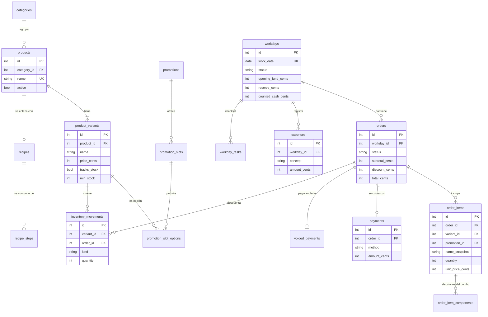

# Café Personal

Asistente local para organizar la jornada en una cafetería: pedidos, cobros, inventario, caja, cierre del día, recetario e informes. Funciona sin Internet y todo se guarda en tu propio equipo.

> Son registros personales y orientativos; no sustituyen el sistema oficial del establecimiento.


## Contenido

- [Qué hace](#qué-hace)
- [Tecnologías](#tecnologías)
- [Puesta en marcha](#puesta-en-marcha)
- [Configuración](#configuración)
- [Entrar desde el celular u otro equipo](#entrar-desde-el-celular-u-otro-equipo)
- [Estructura del proyecto](#estructura-del-proyecto)
- [Modelo de datos](#modelo-de-datos)
- [Reglas de negocio](#reglas-de-negocio)
- [Datos y copias de seguridad](#datos-y-copias-de-seguridad)
- [Seguridad](#seguridad)
- [Pruebas](#pruebas)
- [Actualizar un sistema en uso](#actualizar-un-sistema-en-uso)
- [Estado del proyecto](#estado-del-proyecto)

## Qué hace

| Módulo | Funciones |
| --- | --- |
| Inicio | Cifras del día, accesos rápidos, recordatorios, productos agotados y con existencias bajas |
| Pedidos | Varios productos por pedido, descuento fijo, cobro en efectivo o QR, edición y cancelación |
| Promociones | Combos configurables por secciones (p. ej. una bebida + un producto de panadería) |
| Catálogo | Productos con presentaciones, categorías, fotos y activación sin borrar |
| Recetario | Recetas con pasos, enlazadas a un producto y visibles desde el pedido |
| Inventario | Recepción, conteo físico, ajustes, movimientos y reposición sugerida |
| Caja | Efectivo esperado en vivo (fondo + ventas en efectivo − gastos) y registro de gastos |
| Jornada | Apertura y cierre en pasos, listas de tareas configurables e informe de cierre imprimible |
| Historial e informes | Jornadas por rango de fechas, comparación de 2 a 7 días y exportación a Excel y PDF |
| Notas | Notas, recordatorios y tareas con filtros |
| Configuración | Fondo y reserva por defecto, copias de seguridad y restauración |
| Interfaz | Modo claro y oscuro, buscador global con autocompletado y diseño adaptado a móviles |

## Tecnologías

- **Backend:** Python 3.11, Flask 3
- **Base de datos:** SQLite en un solo archivo, con migraciones numeradas y control por `PRAGMA user_version`
- **Imágenes:** Pillow (las fotos se reducen a 480 px JPEG)
- **Reportes:** openpyxl (Excel) y reportlab (PDF), sin descargas externas
- **Interfaz:** plantillas Jinja2, JavaScript sin dependencias, tipografías e íconos incluidos en el proyecto
- **Pruebas:** unittest

## Puesta en marcha

Necesitas Python 3.11 o superior y Windows 10 o posterior. La instalación es lo único que requiere Internet.

```bat
:: 1. Crea y activa un entorno virtual
python -m venv venv
venv\Scripts\activate

:: 2. Instala las dependencias
pip install -r requirements.txt
```

### Iniciar

Haz doble clic en el acceso directo **Café Personal** del Escritorio, o en `iniciar_servidor.bat`. La ventana queda minimizada y el navegador se abre solo en <http://localhost:31847> cuando el servidor ya responde. Si la aplicación ya estaba encendida, solo abre otra pestaña.

- **Apagar:** cierra la ventana "Cafe Personal" de la barra de tareas.
- **Problemas al iniciar:** aparecen en un mensaje en pantalla.
- **Depurar:** desde una consola en la carpeta del proyecto, `iniciar_servidor.bat min` muestra los mensajes.
- **Otro puerto:** `set CAFE_PORT=numero` antes de iniciar.
- **Sin script:** `python app.py`.

### Crear el acceso directo

Haz doble clic en `crear_acceso_directo.bat`. Crea en el Escritorio el acceso con el ícono `cafe\static\img\cafe.ico`. Repítelo si mueves la carpeta del proyecto.

### Datos de prueba (opcional)

```bat
python cargar_prueba.py            :: productos marcados "(Prueba)"
python cargar_prueba.py --quitar   :: los elimina
```

## Configuración

No hace falta definir nada para empezar: se usa la carpeta `data\` y el puerto 31847.

| Ajuste | Dónde | Para qué sirve |
| --- | --- | --- |
| `datos=` | `ubicacion_datos.txt` | Carpeta donde viven la base, las fotos, las copias y los registros. Sin el archivo se usa `data\` |
| `copias=` | `ubicacion_datos.txt` | Segundo lugar donde se guarda cada copia `.zip` (por ejemplo OneDrive) |
| `CAFE_PORT` | Variable de entorno | Puerto del servidor (por defecto `31847`) |
| `CAFE_DATA_DIR` | Variable de entorno | Carpeta de datos; tiene prioridad sobre `datos=` |
| Fondo y reserva | ⚙ Configuración | Valores por defecto de la apertura y del cierre (Bs 100 cada uno) |

Ejemplo de `ubicacion_datos.txt`:

```
datos=C:\CafeDatos
copias=C:\Users\TuUsuario\OneDrive\CafeCopias
```

> No conviene que la carpeta de datos esté dentro de OneDrive: la sincronización puede bloquear la base mientras se usa. Para eso existe `copias=`.

## Entrar desde el celular u otro equipo

**La aplicación no tiene contraseña.** Quien esté conectado a la misma red puede ver y cambiar todo, incluidas las copias de seguridad. Úsala solo en una red de confianza, no en una Wi-Fi compartida con clientes.

1. Permite el puerto, una sola vez, en una consola abierta como administrador:

   ```bat
   netsh advfirewall firewall add rule name="Cafe Personal" dir=in action=allow protocol=TCP localport=31847 profile=private remoteip=localsubnet
   ```

   La regla vale para redes marcadas como *privadas*: en Windows, Configuración → Red e Internet → Propiedades de la Wi-Fi → Perfil de red: Privado.
2. Averigua la IP con `ipconfig`. Usa la **Dirección IPv4** del adaptador Wi-Fi o Ethernet real, el que tiene *Puerta de enlace predeterminada*. No uses las de adaptadores virtuales (VirtualBox, WSL, Docker, VPN).
3. En el celular, conectado a la misma red, abre `http://IP:31847`, por ejemplo `http://192.168.0.8:31847`. No uses nombres `.local`: en Android no son fiables.
4. Conviene reservar esa IP en el router (reserva DHCP) para que no cambie.

## Estructura del proyecto

```
cafe-manager/
├── app.py                      Punto de entrada (python app.py)
├── cafe/
│   ├── __init__.py             Fábrica de la app, filtros y protecciones
│   ├── config.py               Puerto, ubicación de datos y límites
│   ├── db.py                   Conexión SQLite, transacciones y migraciones
│   ├── money.py                Dinero en centavos y formato "Bs 8,50"
│   ├── errors.py               Manejo de errores (HTML y JSON)
│   ├── migrations/             Esquema versionado (001 a 007)
│   ├── routes/                 Rutas: reciben y validan (un archivo por módulo)
│   ├── services/               Lógica de negocio y transacciones
│   ├── templates/              Plantillas Jinja2
│   └── static/                 CSS, JavaScript, tipografías e íconos
├── tests/                      Pruebas automatizadas
├── cargar_prueba.py            Datos de prueba
├── iniciar_servidor.bat        Arranque minimizado
├── crear_acceso_directo.bat    Acceso directo en el Escritorio
├── ubicacion_datos.txt         Dónde guarda los datos esta instalación
└── requirements.txt            Dependencias
```

Las capas son tres: las **rutas** validan la entrada, los **servicios** aplican las reglas y abren las transacciones, y la **base** guarda los datos.

## Modelo de datos

El dinero se guarda en enteros (centavos). El stock y el efectivo no se almacenan: se calculan a partir de movimientos y pagos.



Además hay tablas de apoyo: `settings`, `checklists`, `checklist_items`, `personal_notes`, `audit_log`, `order_stock_exempt`, `promotion_slot_categories` y la vista `variant_stock`.

## Reglas de negocio

**Jornada.** Solo puede haber una abierta a la vez y una por fecha. Se puede reabrir únicamente la más reciente. No se cierra con pedidos pendientes de pago: hay que cobrarlos o cancelarlos.

**Pedidos.** Se modifican solo con la jornada abierta. Cada línea conserva nombre y precio históricos. Un pedido tiene un único pago (efectivo o QR) y las ventas cuentan en la jornada en que se paga.

**Efectivo esperado** = fondo inicial + ventas en efectivo − gastos. El QR nunca entra en la caja; los pedidos pendientes y cancelados tampoco.

**Inventario.** Las existencias son la suma de los movimientos del producto. El inventario de un pedido se sincroniza siempre por diferencia, así que pagar dos veces, editar o cancelar no duplican ni pierden movimientos. Un producto con control de existencias en cero está agotado y no se puede agregar a un pedido; los pendientes no reservan stock.

**Combos.** Un combo es una sola línea con un único ingreso. Cada elección admite categorías completas (los productos nuevos de esa categoría entran solos) y productos sueltos. Los componentes descuentan stock.

**Promociones ya vendidas.** Si nunca se vendió, se elimina. Si ya aparece en pedidos, se archiva: sale de la lista y del selector, pero los pedidos conservan su historia.

**Reposición.** Objetivo = el mayor entre el promedio vendido por jornada (redondeado hacia arriba) y el stock mínimo. Usa las últimas 6 jornadas cerradas con ventas, del mismo día de la semana por defecto.

## Datos y copias de seguridad

Todo vive en la carpeta indicada en `datos=`: `cafe.db`, `uploads\`, `backups\` y `logs\`. La base se crea y se actualiza sola al iniciar, y antes de actualizar una base con datos se guarda una copia en `backups\`.

- **Crear:** ⚙ Configuración → "Crear copia ahora". Se guarda un `.zip` (base de datos + fotos).
- **Automáticas:** al cerrar cada jornada (se conservan las últimas 30), y antes de actualizar o de restaurar.
- **Llevarla a otro lugar:** en la lista de copias, "Descargar", y guárdala en un USB u otra carpeta.
- **Restaurar:** ⚙ Configuración → "Restaurar" junto a la copia, o "Restaurar desde un archivo" (`.zip` completo o `.db` solo base). La copia se valida antes de usarla y, si algo falla, los datos vuelven solos a como estaban.
- **A mano (con la aplicación detenida):** copia o reemplaza toda la carpeta de datos.

## Seguridad

- La aplicación solo acepta conexiones desde direcciones de red privada y rechaza peticiones con un host que no lo sea, lo que evita que otra página web envíe formularios a esta app.
- Las contraseñas no existen: la protección es la red local. Úsala en una red de confianza.
- La restauración de copias valida el `.zip` (sin rutas peligrosas ni archivos ajenos) antes de tocar nada.
- Las redirecciones aceptan solo rutas internas.
- Las operaciones de dinero e inventario son atómicas (`BEGIN IMMEDIATE`) y la base tiene restricciones que impiden totales incoherentes, pagos dobles y movimientos con signo incorrecto.
- Las fotos se validan como imagen real y se limitan a 5 MB.
- La carpeta de datos queda fuera del repositorio; no subas `cafe.db`, `uploads\` ni `secret.key`.

## Pruebas

```bat
python -m unittest discover -s tests -v
```

Las pruebas usan bases temporales y no tocan tus datos.

| Archivo | Qué comprueba |
| --- | --- |
| `tests/test_etapa1.py` | Arranque, migraciones, esquema, semillas y utilidades de dinero |
| `tests/test_etapa2.py` | Catálogo, categorías, fotos, buscador y recetario |
| `tests/test_etapa3.py` | Pedidos, cobros, cancelación y combos sin doble descuento de stock |
| `tests/test_etapa4.py` | Recepción, conteo físico, ajustes y reposición |
| `tests/test_etapa5.py` | Caja, jornada, cierre, reapertura e informe de cierre |
| `tests/test_etapa6.py` | Historial, informes, Excel y PDF, copias de seguridad y notas |
| `tests/test_promociones.py`, `tests/test_promo_borrar.py` | Configuración de combos, eliminación y archivado |
| `tests/test_correcciones.py`, `tests/test_revision.py` | Regresiones de errores corregidos y revisión general |
| `tests/test_ubicacion.py` | Lectura de `ubicacion_datos.txt` |

## Actualizar un sistema en uso

1. Apaga la aplicación y, si quieres un respaldo extra, crea una copia en ⚙ Configuración.
2. Reemplaza los archivos del programa **sin borrar** `venv\`, `ubicacion_datos.txt` ni la carpeta de datos.
3. Haz doble clic en `crear_acceso_directo.bat`.
4. Ejecuta el comando del firewall si vas a entrar desde otros equipos.
5. Actualiza los favoritos: la dirección antigua con el puerto 5000 ya no funciona.

Al iniciar, la base se actualiza sola si hace falta y guarda una copia antes.

## Estado del proyecto

Las etapas 1 a 6 están completas y probadas: catálogo, pedidos, promociones, inventario, caja y cierre, informes, copias de seguridad y notas, además del rediseño visual con modo oscuro.

**Pendiente**

- Etapa 7: pruebas y acabado (revisión general en Windows y Edge, enlaces, formularios, cálculos, persistencia y funcionamiento sin conexión).
- Los gastos eliminados quedan solo en el registro de auditoría, sin historial propio.
- Revisar las secciones del combo en cada instalación: si las categorías no coinciden con las de la configuración inicial, hay que activarlas desde Promociones.
